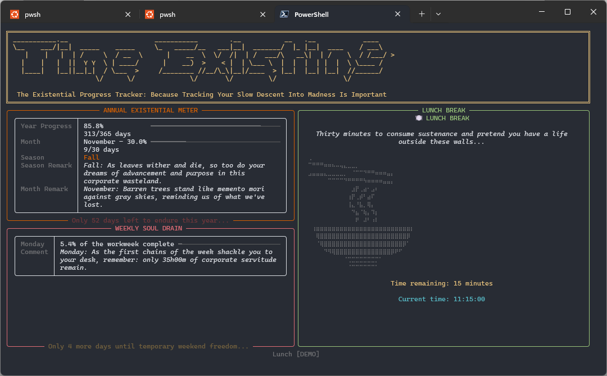

# timeexisting

[](https://github.com/gsaronni/timeexisting/actions/workflows/ci.yml) [](https://www.python.org/downloads/)

A flextime tracker for the terminal that counts your working week and has nothing encouraging to say about it.



*The dashboard in `te --demo`, which cycles through fixed moments of an invented week. No real data appears.*

## What it is and why

`timeexisting` (command `te`) tracks a flextime working week against a fixed contract: 37 hours, a start somewhere between 08:00 and 09:00, a 30 minute unpaid lunch, and unlimited paid breaks. It exists to answer one question, "am I above or below my hours, this week and overall", and it presents everything through a deliberately bleak presentation layer: every line of commentary comes from a voice pack whose register is cynical, dystopian and fond of reminding you that nothing you do here matters.

It began as four lines of PowerShell that hibernated a laptop at 18:00. It is being rebuilt in phases into a proper tracker, and that original behaviour will return as a feature. It is a personal instrument: never a timesheet, never submitted, never defended.

## Features

As of v0.3.3, with phase 3 complete:

- **Dashboard.** A full-screen Rich view of the year, the week and the day: progress through the working day, time remaining, the next lunch or end, the working time left in the week, and seasonal, monthly and weekday commentary.
- **Schedule model.** The day is built from your start time and the contract: a morning block, the lunch window, an afternoon block, and a nominal end at start plus 7h24m plus lunch. Day flags (`no-lunch`, `half-day`, `sick`, `offsite`, `afspadsering`, `fri`) reshape or replace the day.
- **Presence on evidence.** Presence is credited on evidence that someone is at the machine, never on the collector being alive: an unlock, the session's logon time, or input after a wake on an unlocked session. A lock, a sleep or a boot closes it. Replay turns the ledger into a typed timeline of present, away, asleep, off, unevidenced and downtime intervals, each marked observed or inferred.
- **Lock, sleep and wake on Windows.** The collector listens for lock, unlock, suspend and resume notifications and takes their exact times from the Winlogon/Operational and System event logs, which win over its own stamps. The System log is read on every tick, so a sleep that sends no notification is still recorded. Every source is readable without elevation; `te` never asks for admin.
- **Headless collector.** `te collect` records transitions in an append-only JSONL ledger, one shard per machine. Every 30 seconds it overwrites a checkpoint instead of writing to the ledger. A jump in the clock is resolved against the System log, and written as a suspend and resume from the clock only when the log has nothing.
- **Recovery after an unclean stop.** A leftover checkpoint becomes an inferred stop accurate to one tick, and the gap since is backfilled from the event logs, so a crash or a forced restart keeps the locks, unlocks and sleeps the logs still hold.
- **Clean session end on Windows.** Signing out, restarting or shutting down writes a clean stop before the process dies. Since v0.3.3 the collector first leaves the launcher's kill-on-close job, so Windows cannot take it down before the message arrives.
- **One collector per machine.** A lockfile checks both the process id and the process start time, so a recycled pid cannot pass for a live collector, and a stale lock is reclaimed silently.
- **The viewer starts the collector.** `te` starts a detached collector if none is running and reports it in the footer, which also shows this machine's current state (present, away, asleep, unevidenced, or not observing) and since when. `q` or Ctrl+C leaves the viewer and the collector keeps running. A Startup shortcut starts it at every logon.
- **Automatic day start.** On a weekday the start is the day's first present instant, no earlier than `credit.earliest` (07:00 by default), read from the ledger without a prompt. The prompt appears only when the day has no presence yet, defaulting to `credit.default_start`. A weekend takes `credit.default_start` without asking. A start given with `--start`, or typed or confirmed at the prompt, is recorded and wins for the rest of the day; an inferred start is shown in its own style.
- **Timeline diagnostic.** `te collect timeline` prints a day's intervals with type, confidence, source and duration; `--events` adds the ledger events behind them. Read-only.
- **Time travel and demo.** `--at` runs the dashboard at any moment; `--demo` cycles through every phase of the day and every month.
- **Content packs.** Every user-visible string comes from a voice pack and every colour from a palette.

Not yet: the 37 hour balances, the holiday calendar and leave, absence classification, the end-of-day sleep action, statistics and the ledger editor. Presence detection is Windows only; see Install. See the roadmap below.

## Architecture

Two processes and no IPC. The collector runs headless from login, listens for Windows session and power notifications, reads the System and Winlogon/Operational event logs, writes transitions to the append-only ledger, and keeps its liveness in a checkpoint file that is state, not ledger. The viewer replays the ledger into a typed timeline and renders the day; the only thing it writes is the day's start, when one is given or confirmed. The only shared state is files on disk. Underneath, the schedule model and the resolver are pure: they never read a clock or touch I/O, and `now` is always a parameter, which is what lets the dashboard run at any moment in the past or future.

```text
  te collect  (headless, from login)             te  (viewer)
  ----------------------------------             -----------------------------------
  session and power notifications                config.toml --> schedule (pure)
  System and Winlogon/Operational logs                              |
  tick every 30 s --> checkpoint-{host}.json                        |
       |                                                            |
       | start / stop / lock / unlock                               v
       | suspend / resume / boot / input         typed timeline --> resolver (pure)
       v                                              ^             |
  ledger/{host}.jsonl  (append-only, fsync) --replay--+             v
                                                              Rich dashboard
```

The full specification is `docs/timeexisting-roadmap.org`: that file is the contract, this one is the front door.

## Install

Python 3.14 or later. Windows with PowerShell 7 is the primary platform, and the only one with session-end handling and the Startup shortcut. Linux is secondary: the collector and the viewer run, but presence detection (locks, sleeps, the event logs) is Windows only, so on Linux the ledger records collector runs and clock jumps. A Linux shutdown is currently recorded as a deliberate stop (issue #28).

There are two installs, and they never share data. Prod is the one you use: a uv tool installed from a release tag, started at logon, reading the real config and ledger. Dev is this repository's venv, and it never touches the real ledger.

### Prod

Install from a release tag with [uv](https://docs.astral.sh/uv/), then create the Startup shortcut once (`-WhatIf` to preview, `-Uninstall` to remove):

```powershell
uv tool install git+https://github.com/gsaronni/timeexisting@v0.3.3
te --help
pwsh scripts\install-startup.ps1
```

The shortcut runs the tool's own `pythonw.exe` with `-m timeexisting collect`, from your profile folder, so exactly one collector starts at logon and nothing depends on a checkout. Running the script again replaces the shortcut.

To upgrade, stop the running collector first, then install the newer tag over the old one, then start `te`, which starts the new collector. A running `pythonw.exe` locks its files on Windows, so installing first can fail halfway through replacing them. Run these from a shell without the dev venv activated, or `te` is the dev one and stops only the dev collector:

```powershell
te collect stop
uv tool install --force git+https://github.com/gsaronni/timeexisting@<tag>
te
```

### Dev

```powershell
git clone https://github.com/gsaronni/timeexisting.git
cd timeexisting
python -m venv .venv
.\.venv\Scripts\Activate.ps1
pip install -e ".[dev]"
pwsh scripts\dev-setup.ps1
te --help
```

`scripts\dev-setup.ps1` writes a `.pth` file into the venv that sets `TIMEEXISTING_STATE_DIR` and `TIMEEXISTING_CONFIG_DIR` to `.devstate\state` and `.devstate\config` in the repository (ignored by git). It applies to every interpreter the venv starts, activated or not, including a collector the dev viewer spawns, so dev keeps its own config, ledger, lockfiles and logs, and its collector runs beside the prod one without seeing it. Run it again after recreating the venv. The rule: dev never touches the real ledger. Never set either variable as a persistent user or system variable, or prod would follow it.

## Usage

| Command | What it does |
|---|---|
| `te` | Open the dashboard. On a weekday, takes today's start from the ledger when it holds presence for the day; otherwise asks, offering the configured default, or takes that default without asking at night or after `credit.latest`. At a weekend it takes the default. Starts a collector if none is running. |
| `te --start 08:30`, `te -s 08:30` | Open the dashboard with today's start set, skipping the prompt and overriding the ledger. The start is recorded and used for the rest of the day. |
| `te --flag half-day`, `te -f half-day` | Apply a day flag; may be repeated. |
| `te --at "2026-09-17 10:30"` | Run the dashboard at a fixed Europe/Copenhagen moment. Starts no collector. |
| `te --demo` | Cycle through fixed moments: every phase of the day, both weekend days, every month. Starts no collector. |
| `te --no-collector` | Open the dashboard without starting a collector. |
| `te collect` | Run the collector in the foreground. Ctrl+C stops it cleanly. |
| `te collect status` | Report the running collector's pid, host and start time, then the derived state of this host's ledger and since when, or that none is running. |
| `te collect stop` | Ask the running collector to stop and wait for it. |
| `te collect timeline --date 2026-10-16` | Print the day's typed intervals from the ledger in local time: type, confidence, source and duration. Today when `--date` is omitted. `--events` lists the day's ledger events below them. Read-only; needs no collector. |
| `te config path` | Print where the config file is read from. |
| `te config init` | Write the packaged defaults there, if no file exists yet. |
| `te config check` | Load and validate the config. |

`q` or Ctrl+C leaves the dashboard; the collector keeps running.

## Configuration

The packaged defaults describe the contract above. Your own `config.toml` is an overlay: it needs only the keys that differ from the defaults, and everything else keeps its default value. Unknown keys are an error, and the program never rewrites the file. `te config path` shows where it lives (`%APPDATA%\timeexisting\config.toml` on Windows, `~/.config/timeexisting/config.toml` on Linux).

A commented starting point is in [examples/config.toml](examples/config.toml): copy it to the path `te config path` prints and edit it. For example, to mark one machine as work and move the default start to 08:30:

```toml
[credit]
default_start = 08:30:00

[profiles]
hosts = { "MY-LAPTOP" = "work" }
```

`te config init` writes the full defaults as a starting point; delete whatever you do not change. `te config check` validates the result.

## Multiple machines

The repository carries the program, not your data. Config lives in `%APPDATA%\timeexisting\` (`~/.config/timeexisting/` on Linux) and the ledger, lockfiles and diagnostic logs in `%LOCALAPPDATA%\timeexisting\` (`~/.local/state/timeexisting/`), per machine.

To share one config and one ledger across devices, point these at a folder you sync yourself:

| Variable | Overrides |
|---|---|
| `TIMEEXISTING_CONFIG_DIR` | the config directory, holding `config.toml` |
| `TIMEEXISTING_STATE_DIR` | the state directory, holding `ledger\`, `logs\` and the lockfiles |

Every per-machine file in the state directory carries the host in its name: the ledger shard (`ledger\<host>.jsonl`), the lockfiles, the checkpoint, the stop file and the diagnostic logs. Machines sharing one synced state directory therefore never write to the same file.

## Roadmap

Each phase leaves the program working. The specification for all of them is `docs/timeexisting-roadmap.org`.

| Phase | Content | Status |
|---|---|---|
| 0 | Migrate the original script into a package, fix its defects, clock protocol, content packs, theme | complete |
| 1 | Configuration, schedule model, resolver, `--at`, day flags | complete |
| 2 | Collector, ledger, replay, lockfile, logging, Windows session end, Startup shortcut | complete |
| 3 | Lock and sleep detection, event logs, recovery and backfill, presence on evidence, day start, `te collect timeline` | complete |
| 4 | Flex balances, holiday calendar, leave, drift, absence classification | planned |
| 5 | End-of-day sleep action, countdown, postponement | planned |
| 6 | `te stats`, histograms | planned |
| 7 | `te edit`, corrections without hand-editing the ledger | planned |
| 8 | Demo on a scaled clock, notifications, key help, full content pass | planned |
| 9 | Additional voices, palettes and locales | planned |

## Development

```powershell
pre-commit install
ruff format .
ruff check .
pytest
```

All three pass before every commit, and the pre-commit hooks run the formatter and the linter on each one. CI runs the linter and the test suite on Windows and Ubuntu. It also builds the wheel and runs `te --help` from it in a clean environment (`.github/workflows/ci.yml`). An architecture test enforces the purity rule: nothing under `domain/` may import Rich, read a clock or touch I/O.

## How it was built

`timeexisting` was built with [Claude Code](https://claude.com/claude-code). Each phase was first specified as a prompt, kept in `docs/` as `phase-N-prompt.md`, against the roadmap in `docs/timeexisting-roadmap.org`. Claude Code implemented it one step at a time, stopping after each step for review before the next began. `docs/logs.org` records every phase: what was asked, what was done, what was rejected, what was observed and what carried over.

## Licence

MIT. See [LICENSE](LICENSE).

The MIT licence covers the code only. The ASCII art in `src/timeexisting/assets/ascii_art/` is excluded: the artworks remain the property of their artists and are included for personal, non-commercial use under the [asciiart.eu Terms of Use](https://www.asciiart.eu/terms-of-use), with their names and initials intact. See [CREDITS.org](CREDITS.org) for each piece's source and artist.
